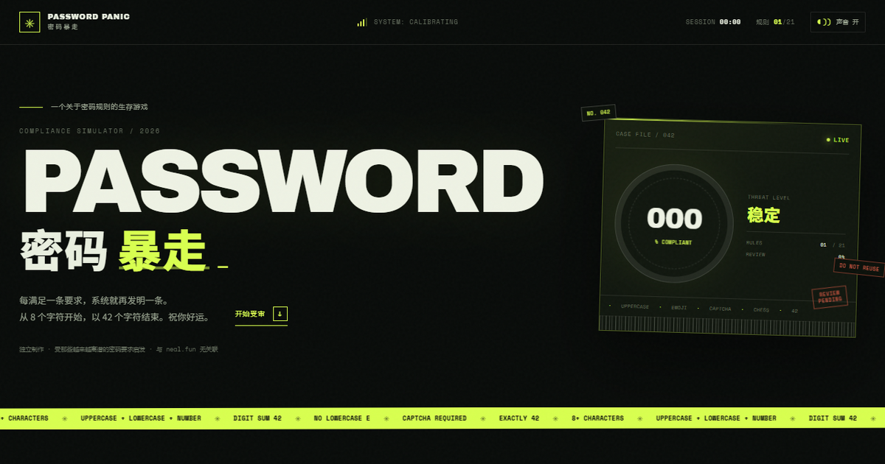

<div align="center">
  
</div>

<h1 align="center">密码暴走 · PASSWORD PANIC</h1>

<p align="center">
  每满足一条要求，系统就再发明一条。<br />
  从 8 个字符开始，以 42 个字符结束。
</p>

<p align="center">
  <a href="https://3095057969.github.io/password-panic/"><strong>▶ 在线试玩</strong></a>
  &nbsp;·&nbsp;
  <a href="https://github.com/3095057969/password-panic">GitHub 仓库</a>
</p>

<p align="center">
  <code>21 条规则</code>&nbsp;
  <code>3 个互动关卡</code>&nbsp;
  <code>纯 HTML / CSS / JavaScript</code>&nbsp;
  <code>无需后端</code>
</p>

---

## 这是什么？

《密码暴走》是一个关于密码规则的生存小游戏。

你只需要做一件事：写一个密码。但系统会一条接一条地提出要求——大小写、数字和、动物表情、颜色、验证码、压力阀、国际象棋……每满足一条，下一条才会出现。有些旧规则还会被新修正案当场废止。

能走到最后的人，会得到一个刚好 42 个字符的密码，以及一点点自由。

> **独立同人作品**：玩法灵感来自 [Neal.fun 的 The Password Game](https://neal.fun/password-game/)。本项目的规则文案、视觉设计、代码和所有互动关卡均为原创实现，与原作无关联。`neal.fun` 名称及相关素材不属于本项目。


## 玩法

1. 在主密码框里输入内容。
2. 系统会逐条揭示合规要求；当前规则全部满足后，下一条才会出现。
3. 有的规则需要改密码，有的规则会突然要求你：
   - 通过一个歪歪扭扭的人机验证码；
   - 连续点击压力阀，把它降到 0；
   - 移动棋盘上的骑士，再把坐标抄进密码。
4. 已解决的规则可能因为后续修改而重新失效——包括被你自己改坏的早期规则。
5. 全部 21 条通过后，会获得一张可复制的通关战报。

进度和密码会自动保存在浏览器的 `localStorage` 中，刷新页面可以接着来。没有账号、没有服务器、没有真实的密码上传。

## 特点

- **21 条逐条解锁的规则**，从普通需求一路升级到荒谬要求。
- **3 个内置互动关卡**：验证码、压力阀、骑士抓虫。
- **实时审查**：每条规则即时校验，数字和、字符数和小写 `e` 都有实时读数。
- **修正案系统**：第 13 条规则会废止第 4 条，旧卡片会保留并标记“已废止”。
- **提示与进度**：当前规则可展开提示，进度条、系统压力和合规率同步变化。
- **本地存档**：密码、已解锁规则和互动结果自动保存。
- **通关结算**：显示用时、字符数，并支持一键复制战报。
- **响应式**：桌面双栏控制台，移动端单栏布局；支持减少动效偏好。
- **零运行时依赖**：不需要构建工具，GitHub Pages 直接托管。

## 本地运行

需要 Node.js 18+（只用它启动静态服务器，运行游戏本身不需要 Node）。

```bash
npm run dev
```

然后打开 [http://127.0.0.1:4173](http://127.0.0.1:4173)。

也可以使用任何静态服务器，或直接双击 `index.html`（ES Module 功能在 `file://` 下可能受浏览器限制，推荐本地服务器）。

## 测试

规则引擎和参考答案的单元测试使用 Node 内置测试运行器：

```bash
npm test
# 或者
node --test tests/rules.test.mjs
```

测试覆盖：规则表完整性、Unicode 字符计数、数字和、三连检测、修正案废止、互动规则、黑名单、精确字符数和完整通关解。

## 项目结构

```text
.
├── index.html              # 页面与所有文案
├── styles.css              # 视觉系统、响应式布局、动效
├── js/
│   ├── rules.js            # 21 条规则与纯校验逻辑
│   └── game.js             # 状态、解锁、互动、存档、结算
├── assets/
│   ├── fonts/              # Archivo Black / Space Mono（OFL）
│   ├── favicon.svg
│   ├── og-image.png
│   └── preview.webp
├── scripts/serve.mjs       # 零依赖本地静态服务器
├── tests/rules.test.mjs    # 规则单元测试
├── site.webmanifest
└── LICENSE
```

## 部署

项目根目录就是可部署的静态站点，没有构建步骤。

GitHub Pages 设置：

1. 仓库 **Settings → Pages**。
2. **Build and deployment → Deploy from a branch**。
3. 选择 `main` 分支和 `/ (root)` 目录。
4. 保存后访问 `https://3095057969.github.io/password-panic/`。

同样可以直接部署到 Cloudflare Pages、Netlify、Vercel 或任何静态托管服务。

## 字体与许可

代码和原创内容以 [MIT License](LICENSE) 发布。

字体文件按 SIL Open Font License 1.1 使用：

- **Archivo Black** — Copyright 2017 The Archivo Black Project Authors.
- **Space Mono** — Copyright 2016 The Space Mono Project Authors.

完整许可文本位于 [`assets/fonts/`](assets/fonts/)，更多信息见 [THIRD_PARTY_NOTICES.md](THIRD_PARTY_NOTICES.md)。

---

<p align="center">
  <sub>别真的把这个密码拿去用。尤其是第 21 条。</sub>
</p>
